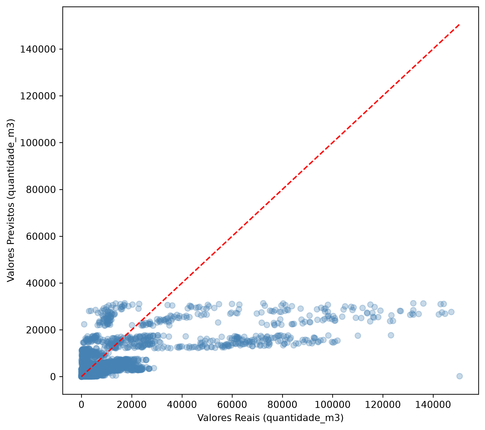
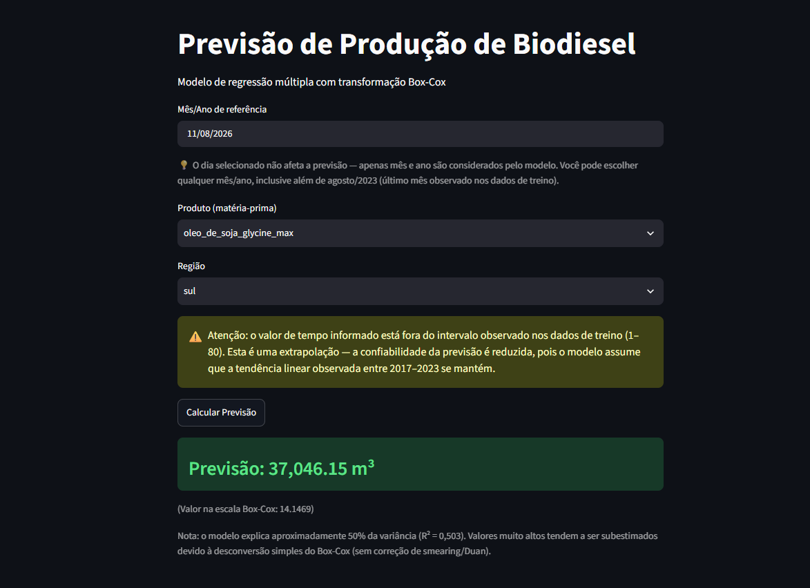

# Regressão Linear Múltipla - Produção de Biodiesel no Brasil
 


 
## 🎯 Sobre o projeto
 
**O problema:** Quem planeja a compra de insumos para a produção de biodiesel precisa saber quais matérias-primas e quais regiões concentram o volume produzido, e como esse volume se comporta ao longo do tempo. Neste projeto usei os dados públicos da ANP para modelar a quantidade de matéria-prima usada na produção de biodiesel (`quantidade_m3`), por mês, estado e produto, em função do tempo, do tipo de matéria-prima e da região.
 
**Quem usaria:** Um cenário plausível é a área de planejamento de compras ou de oferta de um produtor ou distribuidor de biodiesel, que precisa de uma referência do peso de cada matéria-prima e de cada região. O projeto usa dados públicos e não tem cliente real, então esse uso é um cenário, não um caso aplicado.
 
**O que o projeto entrega:** Um modelo de regressão linear múltipla, com diagnóstico completo, e um app em Streamlit que simula a previsão a partir de data, produto e região.
 
**O resultado:** O modelo final explica cerca de metade da variação (R² de 0,5031, na escala Box-Cox, próxima do logaritmo). O óleo de soja é a matéria-prima com maior efeito positivo, e o Sul é a única região acima do Centro-Oeste.
 
**A limitação que mais importa para o negócio:** O modelo subestima bastante os registros de volume grande: no gráfico abaixo (valores reais contra previstos), as previsões não passam de cerca de 30 mil m³, enquanto os valores reais chegam a cerca de 150 mil m³. Não investiguei a causa. Por isso, o resultado serve como referência de padrão entre matérias-primas e regiões, e não como previsão confiável de volumes grandes.

<p align="center">
  
</p>
 
Outras ressalvas: o R² do modelo final está na escala transformada da variável resposta, e todas as métricas foram calculadas na mesma amostra usada para estimar o modelo (veja [Limitações](#️-limitações)).
 
---
 
## 📖 Etapas do Projeto
 
### 1. Coleta dos Dados
 
- **Fonte:** [Painel de Produção de Etanol e Biodiesel](https://dados.gov.br/dados/conjuntos-dados/paineis-de-producao-de-etanol-e-de-biodiesel), ANP
- **Arquivo:** Matéria-Prima utilizada na Produção de Biodiesel (CSV)
- **Período:** jan/2017 a ago/2023 (80 meses)
- **Tamanho:** 4.745 linhas, uma por mês, estado e produto (14 produtos, 14 estados e 5 regiões)

### 2. Metodologia
 
- Limpeza e padronização dos dados (Python + Pandas).
- Dummização de produto, região e estado (regra n-1, `drop_first=True`).
- Estimei primeiro um modelo com todas as variáveis (tempo, produto, região e estado). Incluí estado junto com região de propósito, para demonstrar **multicolinearidade perfeita** (VIF infinito, Cond. No. ≈ 10¹⁶): como cada estado pertence a uma região, o `statsmodels` reduz as 31 colunas a 27.
- Refiz o modelo sem estado e apliquei o **Stepwise** (remoção de variáveis não significativas pelo teste t).
- Testei a normalidade dos resíduos com o **Shapiro-Francia**. A normalidade foi rejeitada.
- Apliquei a transformação **Box-Cox** em Y (λ ≈ 0,054, próximo do log natural). Para isso tirei 13 linhas com `quantidade_m3 = 0`, ficando com 4.732.
- Fiz um segundo Stepwise sobre o modelo transformado.
- Rodei o **Breusch-Pagan** no modelo final para testar a homocedasticidade.

### 3. Resultado do Modelo Final
 
| Modelo | Descrição | R² | Escala de Y |
|---|---|---|---|
| `modelo_biodiesel_1` | Com estado e região (multicolinearidade perfeita, didático) | 0,5022 | m³ |
| `modelo_biodiesel_2` | Sem estado | 0,4196 | m³ |
| `modelo_step_biodiesel` | Stepwise sobre o modelo 2, antes do Box-Cox | 0,4195 | m³ |
| `modelo_step_bc_biodiesel` | **Modelo final**: Box-Cox + 2º Stepwise | **0,5031** | Box-Cox |
 
O R² do modelo final está na escala Box-Cox e não é comparável com os demais, que estão em m³. Não calculei o R² do modelo final na escala original.
 
O modelo final manteve 13 variáveis, todas significativas a 1% (p ≤ 0,008). Como a escala de Y é próxima do log, os coeficientes mostram a direção e a ordem de grandeza do efeito, não o valor direto em m³.
 
**Principais achados:**
 
- **Óleo de soja** é a matéria-prima com maior efeito positivo em relação à categoria de referência (óleo de palma/dendê). `outros_materiais_graxos` também tem efeito positivo, bem menor. Os demais produtos ficam abaixo da referência.
- **Sul** é a única região acima do Centro-Oeste. Norte e Sudeste ficam abaixo, e o Nordeste saiu no Stepwise por não ser significativo.
- **O Box-Cox reduziu bastante a assimetria e a curtose dos resíduos** (assimetria de 2,69 para −0,54; curtose de 17,7 para 3,4), mas o Shapiro-Francia ainda rejeita a normalidade.
- A outra metade da variação pode vir de fatores que não estão no modelo, como preço de commodities, safra agrícola e política de incentivo. Não testei essas hipóteses.

---
 
## ⚠️ Limitações
 
- **Subestimação dos registros grandes.** As previsões ficam em até cerca de 30 mil m³ (máximo de 31.437 m³), e os valores reais chegam a cerca de 150 mil m³ (máximo de 150.567 m³). O gráfico é gerado no notebook, na célula logo após o gráfico de resíduos. Não investiguei a causa. Uma hipótese é a retransformação do Box-Cox (desigualdade de Jensen), mas não a testei, e o tamanho da diferença sugere que pode haver um problema de ajuste na cauda.
- **Não fiz validação fora da amostra.** R², testes de normalidade e homocedasticidade foram calculados na mesma base em que estimei o modelo.
- **Normalidade ainda rejeitada depois do Box-Cox.** O W do Shapiro-Francia subiu de 0,76295 para 0,98078, mas o p-valor continua baixo (5,1e-24).
- **Breusch-Pagan só no modelo final** (p = 0,0841, não rejeita homocedasticidade a 5%). Calculei com a função do material do curso e ainda não comparei com a implementação do `statsmodels`. Pelo que verifiquei, o p-valor dessa função não segue o cálculo padrão da cauda do qui-quadrado, e com o cálculo padrão ele ficaria mais perto de 0,07. A conclusão a 5% se mantém, mas o valor exato precisa ser conferido.
- **Autocorrelação não avaliada.** O Durbin-Watson do modelo final é 1,857 (aparece no `summary()`), mas os dados são um painel com várias linhas por mês, e o teste pressupõe uma única ordem. Por isso, não o interpretei.
- **Estado fora do modelo.** Tirei o estado para eliminar a colinearidade com a região, e o R² em m³ cai de 0,50 para 0,42. Parte da variação explicada pelo estado ficou de fora.
- **R² na escala original não calculado.** O R² de 0,5031 é na escala Box-Cox, então não dá para dizer que o modelo "explica metade do volume em m³".
- **Período observado.** A validade das previsões se restringe a jan/2017 a ago/2023.
**Próximo passo:** avaliar o modelo fora da amostra, treinando nos primeiros meses e testando nos últimos (respeitando a ordem do tempo), investigar a subestimação dos registros grandes e checar a autocorrelação dos resíduos.
 
---
 
## 🖥️ App de Previsão (Streamlit)
 
O `src/app_previsao_biodiesel.py` carrega o modelo final serializado (`outputs/modelo_biodiesel_final.pkl`) e prevê `quantidade_m3` a partir de data (só mês e ano contam), produto e região. O resultado é a previsão para **um registro de estado × produto × mês**, e não um total regional.
 
O app avisa quando o produto ou a região escolhida foi removida pelo Stepwise (nesse caso assume o comportamento da categoria de referência) e quando a data está fora do período observado. A previsão em m³ não tem correção da retransformação do Box-Cox e não traz intervalo de confiança.
 
```bash
cd src
streamlit run app_previsao_biodiesel.py
```
 
<p align="center">
  
</p>

---
 
## ⚙️ Como Rodar
 
Testado com Python 3.11.

```bash
pip install -r requirements.txt
jupyter notebook src/script_biodiesel.ipynb
```

O `requirements.txt` fixa o pandas em **2.3.3** de propósito: com o pandas 3, o `stepwise` do pacote `statstests` usado no notebook nunca remove variável nenhuma e fica em loop infinito.
 
<details>
<summary><b>📁 Estrutura do repositório</b></summary>

    supervised-learning-biodiesel-regressao/
    ├── data/
    │   └── biodiesel-materia-prima.csv
    ├── src/
    │   ├── script_biodiesel.ipynb
    │   └── app_previsao_biodiesel.py
    ├── outputs/
    │   ├── modelo_biodiesel_final.pkl
    │   ├── histograma_residuos_step_biodiesel.png
    │   ├── histograma_residuos_step_bc_biodiesel.png
    │   ├── residuos_fitted_step_bc_biodiesel.png
    │   └── reais_vs_previstos_step_bc_biodiesel.png
    ├── assets/
    │   └── screenshot_app.png
    ├── requirements.txt
    ├── .gitignore
    └── README.md
 
</details>
 
 
